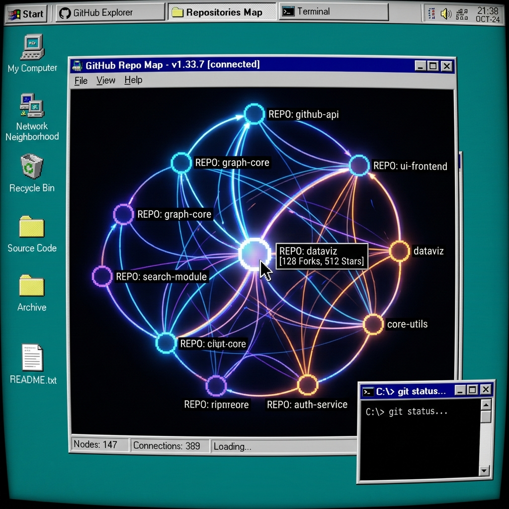

# GitStars Map



GitStars Map turns a GitHub user's starred repositories into an interactive map on a Windows 95-style desktop. Filter by programming language or star count, zoom in, and select a repository to read its description or open it on GitHub.

## Try the map

The hosted demo currently runs an older version that saves entered keys in browser storage. **Leave both credential fields empty on the hosted demo.** If you previously entered keys there, clear that site’s browser data. To use credentials, run the current source locally as described below.

1. Open the [live app](https://git-starmap.vercel.app/). If **API Settings** is closed, double-click its desktop icon.
2. Enter a GitHub username with public stars, leave both credential fields empty, and choose **Save & Close**.
3. Double-click **Stars Map**. The app fetches that account's stars from GitHub. The default view includes up to 50 repositories under **Uncategorized**. Choose **Re-Sync Stars** in the map to refresh it.

## How the current source handles data and optional AI

| When you use | What happens |
| --- | --- |
| Public stars | Your browser requests the username's starred repositories directly from GitHub. A GitHub token is optional. If you supply one, use the least access you need. The token goes to GitHub. |
| AI grouping | Entering an AI key and running the indexer sends the selected repositories' full names, languages, and up to 150 characters of each description for analysis. The provider suggests categories, summaries, and related repositories. Built-in providers (Gemini, OpenRouter, OpenAI, and Groq) receive the AI key and prompt directly from your browser. |
| Custom proxy | The app sends the AI key, selected endpoint, model, and prompt to its own `/api/ai-proxy` function. The function forwards the key, model, and prompt to the selected supported provider endpoint. This mode requires a deployment that runs the function. |

The app keeps the GitHub token and AI key in memory until you reload, close the tab, or reset the app. Your preferences, cached repository list, analysis, and request counters stay in this browser across visits. Use the reset control to clear them on a shared device.

The page loads its two typefaces from Google Fonts.

The browser counts AI requests locally. Your provider sets prices and quotas, and individual requests may incur charges, including **Test Connection**. Check the billing settings for the account associated with your key before enabling AI.

## Project decisions

I maintain GitStars Map and use AI tools to help develop it. The map gained language and popularity filters so a large collection could be narrowed down. At low zoom, small nodes were difficult to select. A later change enlarged their clickable area as the view zoomed out. [Filter change](https://github.com/poferraz/github-stars-visualizer/commit/4fc56c920d1a3d675e53c5d6a3289e0575e9dda4) · [Click-target fix](https://github.com/poferraz/github-stars-visualizer/commit/5f063c9e49924170bfbc7407c3bdf3e9005775b2)

The custom provider originally hit a browser cross-origin restriction. Adding a server-side proxy addressed that problem and made the app's server a recipient of custom-provider credentials. [Proxy change](https://github.com/poferraz/github-stars-visualizer/commit/c80616d40bf28cbb1abc6c2ba3f4af058345525f)

## Run locally

Use Node.js 24 with npm.

```sh
git clone https://github.com/poferraz/github-stars-visualizer.git
cd github-stars-visualizer
npm ci
npm run dev
```

Open the local URL printed by Vite. The development server runs the desktop and the public-stars map. The custom AI route needs a Vercel-compatible function runtime.

## Repository guide

- [Desktop components](src/components/) contain the settings, map window, help, and repository details.
- [Services](src/services/) handle GitHub requests, optional AI analysis, and local request counters.
- [Graph builder](src/utils/graphBuilder.js) turns repositories and analysis into nodes and links for the canvas.
- [Custom AI proxy](api/ai-proxy.js) runs on the server. Its [tests](api/__tests__/) exercise the forwarding rules.

The app uses React, Vite, and the force-graph canvas renderer. See the [contributor guide](CONTRIBUTING.md) for the checks to run when changing it.

## Credits

The map uses [force-graph](https://github.com/vasturiano/force-graph) and draws on the graph view in Obsidian and network visualizations from [The R Graph Gallery](https://r-graph-gallery.com/network.html), [Flourish](https://flourish.studio/visualisations/network-charts/), [Gephi](https://gephi.org/), [RAWGraphs](https://www.rawgraphs.io/), and [DAGitty](https://dagitty.net/). The retro desktop uses the VT323 and Courier Prime typefaces.
